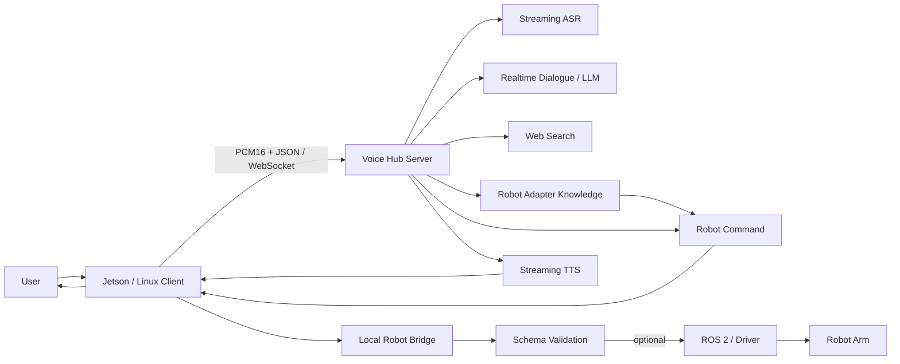

# Voice Hub — Multi-Robot Voice Agent Server

> **WebSocket · Streaming ASR/TTS · Realtime Dialogue · Robot Adapters · Edge Client · Speaker Gate · ROS Bridge**

一个面向多机械臂的私有语音 Agent 中枢：**PC 负责“听、想、说、搜索与多机器人路由”，Jetson / Linux 设备只负责麦克风、扬声器和本地机械臂桥接。**

与把某一种机械臂 JSON 写死在服务器里的方案不同，Voice Hub 使用 **Adapter + Bridge** 设计，让每台机械臂拥有自己的知识库、口语规则、Schema 和执行接口。服务器只处理通用语音协议与路由。

---

## What problem it solves

真实机器人语音系统通常同时遇到四类耦合：

- ASR / TTS / LLM 需要较强算力，不适合每台 Jetson 都复制一套模型；
- 每种机械臂的动作 Schema、ROS 话题、控制协议都不同；
- 设备端必须保证网络掉线、TTS 回声、身份验证和唤醒状态不会直接影响动作安全；
- 搜索、记忆、实时对话等在线能力不应该把密钥下发到设备端。

Voice Hub 的目标是把这些职责拆开：



---

## Architecture highlights

### 1. Host / device split

**Host PC**

- WebSocket server;
- streaming ASR / realtime dialogue / TTS;
- web search;
- per-robot memory;
- adapter loading;
- local knowledge and intent routing;
- cloud API keys.

**Jetson / Linux device**

- microphone + speaker;
- offline wake-word detection;
- command endpointing;
- speaker verification gate;
- robot bridge loading;
- dry-run / execution permission;
- reconnect and playback control.

Cloud credentials stay on the host and are not copied to the robot device.

### 2. Pluggable robot adapters

```text
adapters/
├── _template/
├── demo_single/
└── tianlian_dual/
```

Each robot adapter can define:

- `adapter.yaml`: identity, schema version, ack text;
- `knowledge.yaml`: deterministic robot-specific knowledge;
- `rules.py`: spoken command → robot JSON;
- optional tool declarations.

Adding a new robot does not require rewriting the central server.

### 3. Local execution bridge

The device loads a robot-specific bridge through `jetson_client/plugin.py`.

A bridge is responsible for:

- `validate_commands`;
- `execute_commands`;
- robot-specific ROS / network protocol;
- local safety rejection.

This separation prevents LLM output from being published directly to robot control topics.

---

## Current voice stack

| Capability | Current implementation | Fallback / alternative |
|---|---|---|
| Realtime dialogue | Doubao realtime dialogue WebSocket | OpenAI-compatible Qwen fallback |
| ASR | Doubao streaming SAUC | local sherpa-onnx / Paraformer |
| TTS | Doubao streaming / HTTP TTS | local Kokoro, Edge TTS, dummy |
| Search | Metaso search | provider abstraction retained |
| Memory | per-`robot_id` local JSON | `~/.local/share/voice_hub/memory/` |
| Wake word | local sherpa-onnx KWS | configurable model path |
| Speaker gate | local speaker embedding verifier | off / shadow / enforce |

---

## Device-side wake & turn control

The current Jetson client includes a real offline wake loop, not only CLI text testing.

`jetson_client/wake_kws.py` implements:

- sherpa-onnx keyword spotting;
- wake model discovery;
- KWS score / threshold tuning;
- quiet-speech gain boost;
- post-TTS cooldown;
- keyword token verification.

`jetson_client/wake_loop.py` implements:

- wake → command → host turn → wake loop;
- command start timeout;
- silence endpointing;
- pre-roll;
- TTS playback interruption by wake word;
- stale PCM draining;
- reconnect-friendly session structure.

This allows the device to behave more like a dedicated voice appliance rather than a one-shot CLI client.

---

## Speaker verification gate

`jetson_client/speaker_gate.py` reuses the speaker-verification assets from the VoiceOnline project.

Modes:

- **off** — no verification;
- **shadow** — calculate speaker match but do not block;
- **enforce** — reject unauthorized utterances before sending them to the host.

It supports:

- multi-user enrollment;
- local embedding extraction;
- threshold control;
- live score reporting;
- enrollment sessions;
- minimum speech duration checks.

The gate is an authorization aid, not a replacement for robot emergency stop or replay-attack protection.

---

## Multi-robot isolation

Two adapters are included to prove different command schemas do not leak into each other.

| robot_id | Purpose | Command shape |
|---|---|---|
| `tianlian_dual` | dual-arm robot | action / arm / Cartesian or joint fields |
| `demo_single` | isolation demo | cmd / axis / mm |

The server treats commands as robot-specific opaque payloads after adapter routing; validation remains on the robot side.

This design is important for scaling to a second or third real robot without turning the voice server into a collection of hard-coded `if robot == ...` branches.

---

## Massage integration

Recent versions of the Jetson client include a bridge to the VoiceOnline massage runtime:

`jetson_client/massage.py`

Capabilities include:

- dry-run by default;
- explicit `VOICE_ENABLE_MASSAGE` gate;
- massage start / confirm / teaching operations;
- handoff to the existing `MassageController`;
- cleanup of orphan teaching processes;
- controller resource reclamation;
- clear error states when the robot bridge is missing or busy.

The hub therefore can act as a shared voice brain while a robot-specific execution runtime remains local to the arm.

---

## Protocol

Transport:

- WebSocket;
- JSON text frames;
- binary PCM;
- 16 kHz / mono / signed 16-bit PCM.

Handshake example:

```json
{
  "type": "hello",
  "robot_id": "tianlian_dual",
  "schema_version": 1,
  "audio_params": {
    "format": "pcm_s16le",
    "sample_rate": 16000,
    "channels": 1
  }
}
```

Typical downstream messages:

```text
hello_ok
stt
tts_text
binary PCM
robot_command
turn_end
memory
error
```

The protocol intentionally keeps robot commands as JSON objects owned by the corresponding robot adapter / bridge.

---

## Routing strategy

The server pipeline follows a local-first policy:

1. reject empty / ambient filler;
2. update per-robot memory such as user city;
3. answer deterministic robot knowledge locally;
4. parse deterministic robot actions locally;
5. route weather / news / search to web search;
6. use realtime dialogue for general conversation;
7. fall back to OpenAI-compatible LLM + TTS when needed.

This keeps robot specifications and critical action parsing deterministic while reserving the LLM for open-ended conversation.

---

## Repository structure

```text
voice_hub/
├── server/
│   ├── app.py               # WebSocket server
│   ├── pipeline.py          # routing and orchestration
│   ├── adapter_loader.py    # per-robot adapter loader
│   ├── memory.py            # robot-scoped memory
│   ├── protocol.py          # JSON + PCM protocol
│   └── providers/           # ASR / TTS / LLM / search providers
├── adapters/
│   ├── _template/
│   ├── demo_single/
│   └── tianlian_dual/
├── jetson_client/
│   ├── voice_client.py
│   ├── session.py
│   ├── wake_kws.py
│   ├── wake_loop.py
│   ├── speaker_gate.py
│   └── massage.py
├── device_ui/               # local browser client
├── bridges/                 # demo bridge implementations
├── scripts/                 # launch / diagnostics
├── tests/
└── docs/
```

---

## Quick start

### Host

```bash
git clone https://github.com/NingXYS/voice_hub.git
cd voice_hub

python3 -m venv .venv
source .venv/bin/activate
pip install -r requirements.txt

cp env.example .env
# Fill only the providers you need.
set -a && source .env && set +a

python3 -m server
```

Default endpoint:

```text
ws://0.0.0.0:8765/v1
```

### Device UI

```bash
bash scripts/run_device_ui.sh
```

Open:

```text
http://127.0.0.1:8780
```

Configure the host as a LAN address such as:

```text
ws://192.168.x.x:8765
```

Do not expose the raw robot WebSocket port directly to the public Internet.

---

## Testing

The repository includes tests for:

- protocol validation;
- adapter loading;
- multi-robot isolation;
- search response shaping;
- realtime dialogue audio pumping;
- device UI behavior;
- wake and playback control;
- robot bridge dry-run behavior.

Run:

```bash
python3 -m unittest discover -s tests -q
```

---

## Safety model

Robot motion is disabled by default.

```bash
VOICE_ENABLE_ROBOT_COMMAND=0
VOICE_ENABLE_MASSAGE=0
```

Before enabling real motion:

- verify the local bridge;
- validate the robot schema;
- confirm ROS / driver state;
- prepare a physical emergency stop;
- verify workspace / collision / joint limits in the robot controller.

The voice server does **not** provide functional safety.

---

## Tech stack

| Area | Technologies |
|---|---|
| Backend | Python, asyncio, WebSocket, Starlette, Uvicorn |
| Voice AI | streaming ASR, realtime speech dialogue, streaming TTS, sherpa-onnx KWS |
| LLM / Search | OpenAI-compatible LLM APIs, Metaso search |
| Robotics | ROS 2 bridge architecture, robot-specific JSON schema |
| Edge | Jetson / Linux, ALSA, PCM streaming |
| HRI | wake-word loop, barge-in, speaker verification, memory |
| Architecture | Adapter / plugin pattern, host-device separation, fail-closed execution |

---

## Resume-oriented highlights

This repository demonstrates:

- designing a **multi-robot voice Agent platform**, not a single-robot script;
- separating cloud intelligence from edge robot execution;
- streaming audio over WebSocket;
- deterministic robot knowledge and action routing;
- offline wake-word and speaker verification on the edge;
- extensible Adapter + Bridge architecture;
- safety-first dry-run and local validation.

For robot / embodied AI / HRI roles, the most relevant files are:

- `server/pipeline.py`
- `server/adapter_loader.py`
- `server/providers/realtime_doubao.py`
- `jetson_client/wake_loop.py`
- `jetson_client/speaker_gate.py`
- `jetson_client/plugin.py`

---

## Related repositories

- [voice_control](https://github.com/NingXYS/voice_control) — robot-side voice interaction, massage / exhibition scenarios
- [orbbec](https://github.com/NingXYS/orbbec) — RGB-D perception, grasp planning and MoveIt execution

---

## Security note

API keys belong in `.env` / system environment only. Do not commit credentials or copy host secrets onto Jetson clients.
