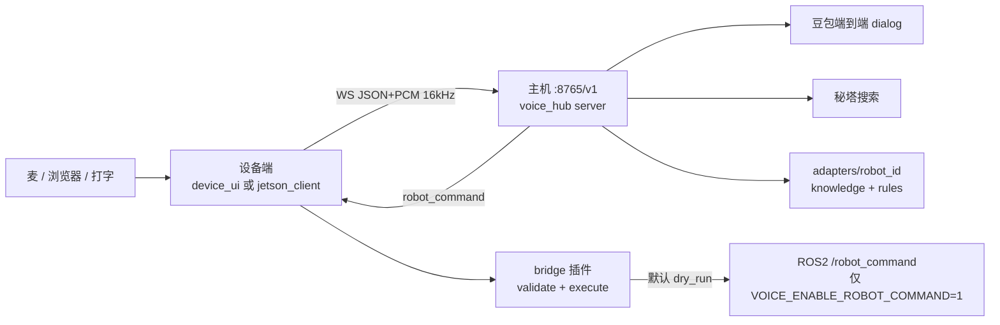

# Voice Hub 交接文档

> 仓库：`/home/ning/model/voice_hub`  
> 天链校验/ROS 桥：`/home/ning/model/lyz/src/tianlian_voice_bridge`（**不在** voice_hub 里，跟机械臂走）  
> 日期：2026-09-03  
> 单元测试：`python3 -m unittest discover -s tests -q`（约 102 项，应全绿）

本文给下一位接手的人：先看**终极目标**，再看**已经能跑什么**，最后按优先级做**下一步**。不要 fork `xiaozhi-esp32-server`，也不要把 ESP32 当机械臂控制器。

---

## 1. 终极目标

做一个**私有的小智式语音服务器**：

| 角色 | 职责 |
|---|---|
| **主机（电脑）** | 听、想、说、搜索、按机械臂选知识库、产出控制 JSON |
| **客户端（Jetson / Linux 设备）** | 麦克风、喇叭、握手、播放；**在本机校验并执行**机械臂指令 |
| **机械臂侧** | 自己的 JSON schema、校验、ROS/驱动；失败则整单拒绝（fail-closed） |

必须同时具备：

1. **快速语音沟通**（闲聊走豆包端到端实时语音，同一条 WebSocket 听+想+说）。
2. **联网搜索**（秘塔 Metaso，不走火山内置 websearch；天气/新闻等可说出来）。
3. **机械臂控制**：口语 → 该臂 JSON → 客户端 bridge 校验 → 才允许动臂。
4. **每台臂自己的知识库**：问「几个关节」由该臂 `knowledge.yaml` 回答，不串台、不靠大模型编规格。
5. **客户端留出与机械臂通讯的口**：当前是 Python 插件 `validate_commands` / `execute_commands`；天链默认发 ROS2 话题 `robot_command`。

安全底线（已写入实现，不要推翻）：

- 密钥只在主机 `.env` / `/etc/voice_hub.env`，**不进 git**，设备端不拷主机 `.env`。
- 大模型输出**不得**直接当 `robot_command`；只有适配器 `rules.py` 解析出的 JSON 才能下发。
- 机械臂 JSON **fail-closed**：字段不对整单丢弃。
- `VOICE_ENABLE_ROBOT_COMMAND` 默认 `0`（只校验 `dry_run`）。真机 + 急停就绪后再开。

---

## 2. 现在的架构



**一句话路由（主机 `server/pipeline.py`）：**

1. 空话/语气词 → 请再说一次  
2. 「我在长春」→ 写入该 `robot_id` 记忆  
3. 命中该臂 `knowledge.yaml` → 知识库口播（接管，不走大模型）  
4. 命中该臂 `rules.py` → `robot_command` 先发、再口播「好的，正在执行」  
5. 天气且还没城市 → 反问城市  
6. 天气/新闻/搜索类 → 秘塔 + 端到端同一音色播报  
7. 其余闲聊 → 豆包 dialog；dialog 挂了才回退百炼 Qwen + HTTP TTS  

百炼 **不是**主路径。对话密钥有效且 `dialog=on` 时，闲聊/天气都可以不填 `CHAT_LLM_API_KEY`。

---

## 3. 端口、进程、仓库

| 进程 | 地址 | 启动 | 说明 |
|---|---|---|---|
| 语音主机 | `ws://0.0.0.0:8765/v1` | `bash scripts/run_server.sh` | 大脑；加载 `.env` |
| 设备端 UI | `http://127.0.0.1:8780/` | `bash scripts/run_device_ui.sh` | 本机浏览器麦/喇叭；**不加载主机密钥** |
| 设备端语音 WS | `ws://127.0.0.1:8780/ws/voice` | 同上 | 连续对话用 |
| CLI 客户端 | 连主机 8765 | `bash scripts/run_client.sh` | Jetson 薄客户端（arecord/aplay） |

协议：`server/protocol.py`。首包必须是：

```json
{"type":"hello","robot_id":"tianlian_dual","schema_version":1,
 "audio_params":{"format":"pcm_s16le","sample_rate":16000,"channels":1}}
```

之后：`listen` start/stop + 二进制 PCM，或 `{"type":"text","text":"..."}`。下行：`stt` / `tts_text` / 二进制 PCM / `robot_command` / `turn_end` / `memory`。

**两套机械臂适配器（证明互不串台）：**

| robot_id | 目录 | JSON | 执行 |
|---|---|---|---|
| `tianlian_dual` | `adapters/tianlian_dual/` | `action/arm/x,y,z` 或关节 | `tianlian_voice_bridge`（ROS `robot_command`） |
| `demo_single` | `adapters/demo_single/` | `cmd/axis/mm` | `bridges/demo_single.py`（永远 dry_run） |

天链 JSON 权威在 `tianlian_voice_bridge/schema.json`（`home` / `get_status` / `move_joint` / `move_cartesian`）。voice_hub **不写死**某一种臂。

新臂接入口（已预留）：

1. 拷 `adapters/_template/` → `adapters/<robot_id>/`  
2. 写 `knowledge.yaml`、`rules.py`（`parse_action`）  
3. 设备上提供 Python 模块，导出 `validate_commands` / `execute_commands`  
4. 客户端 `ROBOT_BRIDGE_MODULE=你的包名`，或在 `jetson_client/plugin.py` 的 `DEFAULT_MODULES` 登记  

---

## 4. 已经完成的内容

### 4.1 私有语音主机

- WebSocket 服务 `server/app.py`：多连接、hello 校验 `robot_id` + `schema_version`。
- 半双工：播报时不抢话，避免喇叭回声把回复掐断；孤立的 `listen stop` 仍会 `turn_end`。
- 云能力都在主机：豆包 ASR（SAUC）、豆包端到端 dialog（`volc.speech.dialog`）、豆包 HTTP TTS（dialog 没声时的最后一招）、秘塔搜索。
- 启动日志应类似：  
  `dialog=on dialog_auth=api_key dialog_speaker=zh_female_vv_jupiter_bigtts search=metaso`

### 4.2 快速语音（端到端）

- 实时对话：`wss://openspeech.bytedance.com/api/v3/realtime/dialogue`。
- 音色必须是 dialog 的 `*_jupiter_bigtts`。`.env` 里若仍是 seed-tts 的 `uranus`，主机会映射成 `zh_female_vv_jupiter_bigtts`。
- 知识库/控制接管时用 **ChatTTSText 两包**（先 `start:true,end:false`，再 `start:false,end:true`），与闲聊同一音色。
- 键盘输入会先补 `EndASR`，否则 ChatTTSText 会被服务端丢掉。
- **ChatEnded（559）不是播完**：文字结束之后 TTS 还在流。泵音频要等到 359（TTSEnded），否则会只听到一个逗号。此修复已进代码。
- 字幕跟**首包音频**一起下发，避免「字先出、两秒后才出声」的错觉。

### 4.3 联网搜索

- 秘塔 `POST https://metaso.cn/api/v1/search`，`METASO_API_KEY`（`mk-` 开头）。
- 查询会带**服务器当天日期**和记忆中的城市，例如 `2026年9月3日 长春天气怎么样`。
- 天气没有城市会先问「你在哪个城市」。
- 播报走 ChatTTSText，滤掉景点/美食/排行榜一类网页噪音；不把搜索结果丢给百炼。
- Clash 假 IP `198.18.x` 会搞挂 `openspeech.bytedance.com` / `metaso.cn`，需直连或给 Python 配系统代理。自检：  
  `python3 scripts/check_search.py --live`  
  `python3 scripts/check_dialog.py --tts`

### 4.4 每台臂的知识库 + 控制

- `adapters/<id>/knowledge.yaml`：关键词命中即口播（「你有几个关节」等）。
- `adapters/<id>/rules.py`：口语 → 该臂 JSON。天链已支持例如「左臂向上 10 厘米」「左臂关节 1 旋转 30 度」；缺手臂/距离会澄清，不编造。
- 主机先发 `robot_command`，再 TTS 应答。客户端 `HubSession` 收到后调用 bridge。
- 天链 / demo 两套 JSON **交叉校验会拒绝**（测试覆盖）。

### 4.5 客户端与机械臂通讯口

- `jetson_client/session.py`：无云密钥；只连主机。
- `jetson_client/plugin.py`：按 `robot_id` 加载 bridge。
- `tianlian_voice_bridge.execute_commands`：校验失败 → `rejected`；未开权限 → `dry_run`；开启后 ROS2 `std_msgs/String` 发到话题 **`robot_command`**。
- 设备 UI：连接、连续对话、打字试音、按臂记忆（城市/称呼/最近 8 轮）。记忆存在主机 `~/.local/share/voice_hub/memory/<robot_id>.json`。

### 4.6 运维与测试

- `env.example` 说明各密钥；`scripts/check_asr.py` / `check_dialog.py` / `check_search.py` 不打印密钥。
- 设备桌面图标：`scripts/install_linux_device_desktop.sh`。
- 测试目录 `tests/`：协议、适配器、搜索口播、dialog 泵、设备 UI、两套 bridge 隔离。

---

## 5. 已验证 / 仍不稳的现象

**本机（浏览器设备端 + 主机）已经能：**

- 握手 `tianlian_dual`（界面显示「施耐力双臂」）。
- 打字或说话问天气、闲聊、知识库问题。
- dialog 连通（`dialog=on`），搜索能返回并开口。

**交接时仍可能遇到（不要当成「没做」）：**

| 现象 | 原因 / 处理 |
|---|---|
| 百炼「聊天密钥无效」 | 闲聊主路径不需要百炼。只有 dialog 挂了才会走它。 |
| ChatTTSText 无声、改走 HTTP TTS、音色变了 | 必须两包协议 + ASREnded；dialog 音色必须是 jupiter。重启主机后再试。 |
| 字幕先出、约 2s 才出声 | 旧逻辑提前下发全文；已改为跟首包音频一起。仍受豆包首包时延影响。 |
| TTS 只剩一个逗号、后文被掐 | 把 ChatEnded 当成结束。已改为等 359。设备页必须**强刷**才能拿到新 `app.js`。 |
| 天气日期是网页旧文（如 6 月 17 日） | 秘塔摘要质量；查询已带当天日期，仍可能抽到旧页面。 |
| `dns → 198.18.x` | Clash fake-ip，把火山/秘塔设直连。 |
| 机械臂「好的正在执行」但臂不动 | 默认 `dry_run`。真机才设 `VOICE_ENABLE_ROBOT_COMMAND=1`。 |

---

## 6. 下一步要完成的内容（按优先级）

### P0 — 产品路径要「能交出去」

1. **真机控制闭环**  
   - 天链 ROS2 已在听 `robot_command` 的前提下，本机急停就绪，再开 `VOICE_ENABLE_ROBOT_COMMAND=1`。  
   - 验收：「左臂向上 10 厘米」→ 客户端日志 `bridge: published` → 臂按 schema 动。  
   - `home` / `get_status` 已在 schema 里，**口语规则还没解析**，需要补 `rules.py`。

2. **Jetson 常驻客户端（对标小智设备）**  
   - 现在好用的是浏览器 `device_ui`；`jetson_client` 仍偏 CLI（`--text` / 录一段）。  
   - 需要：开机自启、持续听、半双工播放、收到 `robot_command` 调 bridge、掉线重连。  
   - 唤醒词在 `adapter.yaml` 写了「小西小西」，**客户端尚未实现**。

3. **端到端时延压到「能对话」**  
   - 目标：从说完到首包音频约 1s 量级（豆包宣称裸模型约 0.7s）。  
   - 继续打日志 `tts_first_audio_ms=`；避免再出现空等 EndASR、过早 `turn_end`、播放队列互抢。

### P1 — 搜索与多臂

4. **搜索口播质量**  
   - 天气应是「今天长春…气温…」短句，不要景点榜。  
   - 可考虑秘塔摘要字段或本地再裁一句；日期必须用主机 `today_label()`。

5. **第二台、第三台真实机械臂**  
   - 按第 3 节模板加 `adapters/<id>` + 该臂 bridge（ROS 话题或网口，由臂的包决定）。  
   - 设备 UI 的 robot_id 列表目前写死 `tianlian_dual` / `demo_single`，应改为扫描或配置。

6. **知识库可运营**  
   - 现在改 YAML 要重启主机。需要热加载或一个很简单的编辑入口（仍按 `robot_id` 隔离）。

### P2 — 部署与体验

7. **systemd / 开机启动**：主机 `run_server.sh`、设备 `run_device_ui.sh` 或 Jetson 客户端。  
8. **局域网说明**：设备填 `ws://<主机局域网IP>:8765`，不要 `127.0.0.1`、不要 `198.18.x`、不要公网转发 8765。  
9. **离线回退**：本机 Paraformer + Kokoro 路径已留（`ASR_PROVIDER=sherpa_local`、`TTS_PROVIDER=local`），未当主路径验收。  
10. **多设备同时在线**：协议按连接隔离，未做压力测试和会话配额。

**明确不做：**

- 不 fork xiaozhi-esp32-server，不把 ESP32 当臂控。  
- 不把 LLM 流式 JSON 直接写入 `/robot_command`。  
- 不把云密钥下发到 Jetson。

---

## 7. 本机怎么跑（交接验收）

主机：

```bash
cd /home/ning/model/voice_hub
# .env：DOUBAO_TTS_API_KEY（dialog/ASR 可复用）、METASO_API_KEY、DOUBAO_TTS_VOICE
bash scripts/run_server.sh
```

设备页（可与主机同一台机）：

```bash
bash scripts/run_device_ui.sh
# 浏览器打开 http://127.0.0.1:8780/  强刷
# 主机地址本机填 ws://127.0.0.1:8765 ，robot_id=tianlian_dual
```

建议按顺序说/打字：

1. 「你有几个关节」→ 知识库，十二个关节。  
2. 「我在长春」→ 记住城市。  
3. 「长春天气怎么样」→ 「我查一下」+ 短天气，同一音色。  
4. 「中午吃什么」→ 整段说完，不能只剩逗号。  
5. 「左臂向上 10 厘米」→ 先有 `robot_command`，再「好的，正在执行」；未开权限时 bridge=`dry_run`。

命令行（不经过浏览器）：

```bash
PYTHONPATH="/home/ning/model/voice_hub:/home/ning/model/lyz/src/tianlian_voice_bridge" \
  python3 jetson_client/voice_client.py --text "你有几个关节"
```

---

## 8. 密钥清单（只在主机）

| 变量 | 用途 | 是否必须 |
|---|---|---|
| `DOUBAO_TTS_API_KEY` 或 APPID+TOKEN | TTS / 常被 dialog、ASR 复用 | 是（在线语音） |
| 控制台开通「豆包端到端实时语音」 | `volc.speech.dialog` | 要快速闲聊就必须开 |
| `METASO_API_KEY`（`mk-`） | 联网搜索 | 要天气/新闻就必须 |
| `CHAT_LLM_API_KEY`（百炼 `sk-`） | 仅 dialog 挂了时的闲聊备用 | **可选** |
| `VOICE_ENABLE_ROBOT_COMMAND` | 真发 ROS | 默认 0 |

不要把 `.env` 提交进 git，不要在日志里打印密钥。

---

## 9. 关键代码地图

| 路径 | 作用 |
|---|---|
| `server/app.py` | WS 主机、dialog 泵、搜索/接管播报 |
| `server/pipeline.py` | 路由：知识 / 控制 / 搜索 / 闲聊 |
| `server/providers/realtime_doubao.py` | 豆包端到端二进制协议 |
| `server/providers/search_tavily.py` | 秘塔（文件名历史原因） |
| `adapters/<robot_id>/` | 每台臂知识库 + 口语规则 |
| `jetson_client/session.py` | 设备会话；执行 `robot_command` |
| `jetson_client/plugin.py` | 加载机械臂 bridge 的口 |
| `device_ui/` | 本机浏览器客户端 |
| `../lyz/src/tianlian_voice_bridge/` | 天链 schema、校验、ROS 发布 |

---

## 10. 交接检查清单

- [ ] 主机 `run_server.sh` 出现 `dialog=on`、`search_key=set`  
- [ ] 设备页强刷后能握手施耐力双臂  
- [ ] 知识库、天气、闲聊、控制口播四条验收通过  
- [ ] `VOICE_ENABLE_ROBOT_COMMAND` 仍为 0，除非当场要真机动  
- [ ] 真机动臂前：急停、ROS 话题、`tianlian_voice_bridge` 在 `PYTHONPATH`  
- [ ] 下一位知道：新臂只加 adapter + bridge，不要改主机去「写死一种 JSON」
